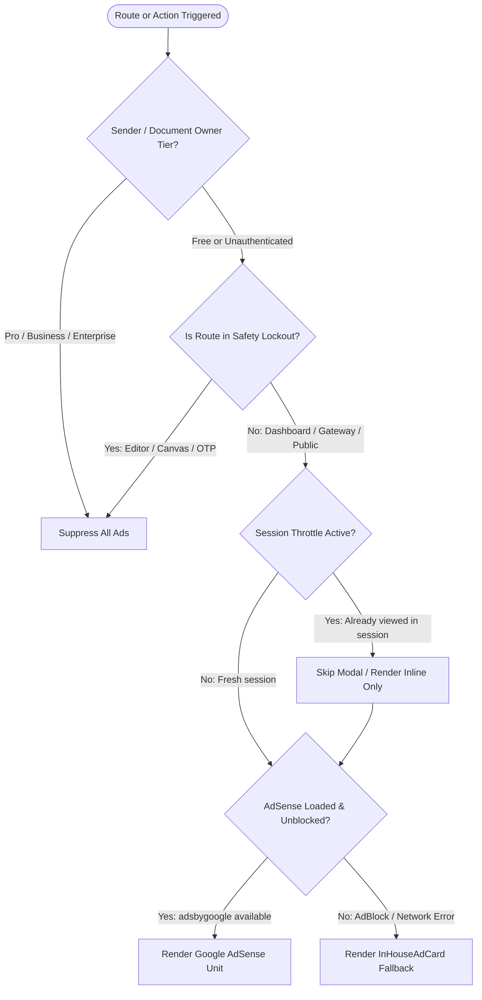

# Free-Tier Ad Monetization & Google AdSense Integration Specification

**Product**: PactDoc  
**Version**: 1.0.0  
**Target Architecture**: React 18 (Vite Client) + Google AdSense Engine  
**Status**: Specification & Production Blueprint  

---

## 1. Executive Strategy & Business Model

PactDoc provides a generous Free tier to drive product-led growth, organic document sharing, and bottom-up customer acquisition across India. While Paid tiers (Pro, Business, Enterprise) operate entirely ad-free with white-label branding, the Free tier is monetized through:

1. **Third-Party Display Network**: Google AdSense contextual banner units across non-critical screens.
2. **Sponsor Gates**: Time-limited (10-second) interstitial access gateways for signers reviewing documents sent by Free-tier accounts.
3. **Internal Conversion Funnel**: First-party in-house promotion cards ("PactDoc Pro: Remove Sponsor Gates & Watermarks") acting as a zero-credential fallback whenever AdBlockers or offline states occur.

### Core Legal & UX Constraints
An e-signature workflow is an evidentiary, legally binding environment. Ad integration must respect three non-negotiable boundaries:
- **Zero Interruption During Document Execution**: No ads, overlays, floating banners, or layout shifts are ever permitted while a user is actively placing fields, typing, drawing signatures, or verifying OTPs.
- **Clear Separation & Sponsored Labeling**: All third-party content must be isolated within dedicated cards labeled "Advertisement" or "Sponsored" to prevent confusing ad creatives with legal contract buttons.
- **Privacy & PII Protection**: Ad units must never scrape, target, or inspect document text, party names, Aadhaar/PAN identifiers, or financial values.

---

## 2. Google AdSense Account Setup & Approval Blueprint

### 2.1 Prerequisites Checklist Before Submission
Google enforces strict automated publisher reviews. For SaaS applications, submission before meeting these requirements results in immediate rejection ("Valuable Inventory: No Content" or "Site Under Construction").

| Requirement | Specification | Status / Verification |
| :--- | :--- | :--- |
| **Custom Domain** | Must be deployed on the live production domain (`https://pactdoc.com`). Staging, `.vercel.app`, or IP URLs are rejected. | Required |
| **SSL / HTTPS** | Valid certificate with HSTS. All HTTP traffic redirects to HTTPS. | Required |
| **Publicly Crawlable Content** | Google crawlers cannot log in. The site must expose public indexable pages: `/`, `/pricing`, `/userguide`, and the template directory (`/t/*`). | Required |
| **Mandatory Legal Pages** | Distinct footer links to: Privacy Policy (with third-party cookie/ad clause), Terms of Service, and Contact/About. | Required |
| **Clean Navigation** | No broken internal links (zero 404s), no placeholder "Lorem Ipsum" text, and fast Core Web Vitals. | Required |

### 2.2 Step-by-Step Account Creation
1. **Registration**:
   - Access [adsense.google.com](https://adsense.google.com).
   - Sign in with the corporate Google Account.
   - Enter root domain: `pactdoc.com` (no protocol, no subfolder).
   - Select payment territory: **India** *(Note: Permanent setting; cannot be modified post-creation)*.
2. **Account Type & Entity**:
   - Select **Individual** or **Business** (LLP/Pvt Ltd).
   - Enter physical address for future PIN mailer verification (triggered upon reaching $10 / ₹1,000 threshold).
3. **Site Verification Script Tag**:
   - Retrieve the AdSense client ID snippet:
     ```html
     <script async src="https://pagead2.googlesyndication.com/pagead/js/adsbygoogle.js?client=ca-pub-XXXXXXXXXXXXXXXX" crossorigin="anonymous"></script>
     ```
   - Insert into the `<head>` of `client/index.html`.
4. **Deploy `ads.txt`**:
   - Create a static file `client/public/ads.txt` containing the publisher verification record:
     ```text
     google.com, pub-XXXXXXXXXXXXXXXX, DIRECT, f08c47fec0942fa0
     ```
   - Verify it resolves publicly at `https://pactdoc.com/ads.txt`.
5. **Request Review**:
   - Submit for site audit in the AdSense portal. Approval typically concludes within 24 hours to 7 business days.

### 2.3 Post-Approval Configuration
1. **Disable "Auto Ads"**:
   - Navigate to **Ads** $\rightarrow$ **By site** $\rightarrow$ `pactdoc.com` $\rightarrow$ Toggle **Auto Ads OFF**.
   - *Rationale*: Auto Ads dynamically injects random overlays and floating banners that break signature canvases and navigation modals.
2. **Create Manual Responsive Ad Units**:
   - Generate two dedicated Display Units:
     - `PactDoc_Dashboard_Banner` $\rightarrow$ Responsive display unit for dashboard and template library.
     - `PactDoc_Signer_Modal` $\rightarrow$ Compact responsive unit for the sponsor gate.
3. **Environment Secrets**:
   - Store credentials in `client/.env`:
     ```env
     VITE_GOOGLE_ADSENSE_CLIENT_ID="ca-pub-XXXXXXXXXXXXXXXX"
     VITE_GOOGLE_ADSENSE_SLOT_ID="XXXXXXXXXX"
     ```

---

## 3. Ad Formats & Placement Architecture

```
┌────────────────────────────────────────────────────────────────────────┐
│ PACTDOC APPLICATION SHELL                                             │
├────────────────────────────────┬───────────────────────────────────────┤
│ Sender Flow                    │ Recipient / Signer Flow               │
│                                │                                       │
│ 1. Dashboard Base Banner       │ 1. Pre-Sign Sponsor Gate Modal       │
│    [Responsive AdBanner]       │    [AdInterstitialModal (10s lock)]   │
│                                │                                       │
│ 2. Post-Upload Confirmation    │ 2. Post-Sign Completion Screen        │
│    [InHouseAdCard or AdSense]  │    [Sponsored Completion Summary]     │
│                                │                                       │
│ 3. Template Library (`/t/*`)   │ 3. PDF Signing Canvas                 │
│    [Sidebar / Header AdBanner] │    [STRICT SAFETY LOCK - ZERO ADS]    │
└────────────────────────────────┴───────────────────────────────────────┘
```

### Detailed Surface Specifications

#### Surface 1: Dashboard Baseline Banner
- **Target User**: Sender on Free Tier.
- **Location**: Rendered beneath the active document table or anchored at the bottom of the dashboard navigation column.
- **Format**: Responsive horizontal display banner (`format="auto"`).
- **Behavior**: Non-sticky, scrolls with page content, respects dark mode obsidian background (`bg-neutral-950`).

#### Surface 2: Signer Gateway (Pre-Sign Sponsor Gate)
- **Target User**: Any recipient opening a signing link where the **document owner is on the Free tier**.
- **Location**: Full-screen modal overlay before the PDF canvas mounts (`AdInterstitialModal.jsx`).
- **Mechanics**:
  - 10-second countdown with visual gradient progress bar.
  - "Proceed to Review & Sign" button remains disabled until countdown completes.
  - Frequency capped: Session storage flag prevents repeated displays if the user refreshes or reopens within the same browser session.
  - Pro Upsell Banner: *"Sender can upgrade to PactDoc Pro to remove sponsor screens for all recipients."*

#### Surface 3: Post-Sign Success Summary
- **Target User**: Signer after applying signatures, initials, and OTP verification.
- **Location**: Inside the download & audit summary view.
- **Format**: Native sponsored banner card displayed alongside "Download Signed PDF" and "Save Audit Trail".

#### Surface 4: Public Legal Templates (`/t` and `/t/[key]`)
- **Target User**: Unauthenticated organic visitors browsing free rental, NDA, and employment agreements.
- **Location**: Sidebar or footer of the public template preview.

---

## 4. Triggering Logic & Decision Engine

The client application evaluates a 4-tier decision pipeline prior to rendering any ad unit:



### Triggering Rules Matrix

| Rule Parameter | Condition | Resulting Behavior |
| :--- | :--- | :--- |
| **`sender.plan`** | `=== 'business' \|\| 'pro' \|\| 'enterprise'` | Total ad suppression across all sender and recipient views. |
| **`sender.plan`** | `=== 'free'` | Eligible for ad placement. |
| **Route Check** | Route matches `/editor/*`, `/assign/*`, or active signing canvas | **Hard Safety Lock**: Immediate suppression. |
| **Signer Interstitial** | `sessionStorage.getItem('sig_ad_viewed') === 'true'` | Bypass modal immediately; proceed directly to signing. |
| **AdBlocker Detection** | `!window.adsbygoogle || adsbygoogle.length === 0` | Render high-converting `InHouseAdCard` promoting PactDoc plans. |
| **Offline / PWA State** | `navigator.onLine === false` | Render cached static fallback card. |

---

## 5. Component Inventory & Integration Guide

The core building blocks are implemented in `client/src/components/ads/`:

### 1. `AdBanner.jsx`
- **Purpose**: General-purpose responsive AdSense unit.
- **Props**:
  - `slotId` (string): Custom slot identifier.
  - `format` (string, default: `"auto"`).
  - `responsive` (boolean, default: `true`).
  - `compact` (boolean, default: `false`).
- **Internal Logic**: Pushes to `(window.adsbygoogle = window.adsbygoogle || []).push({})` on mount. Falls back to `<InHouseAdCard />` on error or empty client ID.

### 2. `AdInterstitialModal.jsx`
- **Purpose**: 10-second sponsor gate for free-tier document recipients.
- **Props**:
  - `documentName` (string): Name of document being unlocked.
  - `onProceed` (function): Callback executing document load and modal unmount.
  - `show` (boolean): Visibility toggle.
- **Internal Logic**: Manages a 1-second interval timer, updates progress percent, sets `sig_ad_viewed` in `sessionStorage`, and unlocks access button.

### 3. `InHouseAdCard.jsx`
- **Purpose**: Self-monetizing fallback and upgrade card.
- **Variants**:
  - `compact={false}`: Full featured card with feature highlights (50 documents/mo, unlimited templates, custom branding, zero sponsor screens).
  - `compact={true}`: Slim banner with one-click CTA to `/billing/plans`.

---

## 6. AdBlocker Defense & Revenue Assurance

Unlike media sites that lock out users with aggressive anti-adblock scripts, PactDoc utilizes a **Value-Add Fallback Strategy**:

1. **No Hostile Blockers**: If an ad blocker blocks `pagead2.googlesyndication.com`, the app does not show an annoying "Disable Adblocker" popup.
2. **Automated Conversion Replacement**: The `<InHouseAdCard>` component takes over the exact DOM slot with zero layout shift.
3. **Monetization Continuity**: Instead of earning fractions of a rupee per CPM impression, the user is directly funneled into the high-margin ₹299/mo Pro or ₹799/mo Business subscription pipeline.

---

## 7. Production Roadmap Tasks

| Task ID | Component / Milestone | Verification Criteria |
| :--- | :--- | :--- |
| **AD-01** | Create AdSense Account & Verify Domain | Domain approved in Google AdSense console with `ads.txt` verified. |
| **AD-02** | Environment Variables Configuration | `VITE_GOOGLE_ADSENSE_CLIENT_ID` and `SLOT_ID` configured in Vercel/production `.env`. |
| **AD-03** | Hook Dashboard Baseline Ad | Mount `<AdBanner />` on `Dashboard.jsx` conditional on `user.plan === 'free'`. |
| **AD-04** | Hook Signer Sponsor Gateway | Mount `<AdInterstitialModal />` on `SigningPage.jsx` when document owner is on Free tier. |
| **AD-05** | Public Template Library Monetization | Mount responsive `<AdBanner />` inside `TemplatePublic.jsx` sidebar. |
| **AD-06** | AdBlocker & Mobile Audit | Test on Chrome mobile (360px viewport) with and without uBlock Origin active. |
