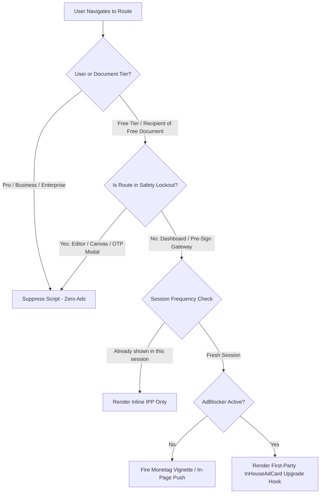

# Monetag Ad Integration & Step-by-Step Setup Guide

**Product**: PactDoc  
**Version**: 1.0.0  
**Monetization Network**: Monetag (by PropellerAds)  
**Target Environment**: React 18 (Vite Client)  
**Status**: Active Production Specification  

---

## 1. Why Monetag for PactDoc?

While Google AdSense requires weeks of manual review, extensive text content, and rejects web apps behind login walls, **Monetag** is tailored for web applications, SaaS tools, and utilities:
- **Instant Site Approval**: No waiting weeks; domains are verified and activated within minutes.
- **Zero Content / Traffic Minimums**: Works immediately on new domains from Day 1.
- **High Fill Rates in India & Global**: High CPM for Indian traffic across mobile and desktop.
- **Dynamic SPA Compatibility**: Works smoothly in modern Single Page Applications without fragile container hydration errors.

---

## 2. Step-by-Step Monetag Account Setup

Follow these exact steps to create and configure your Monetag publisher account.

### Step 1: Account Registration
1. Visit [https://monetag.com](https://monetag.com) and click **Sign Up** $\rightarrow$ **Publisher Account**.
2. Select **Individual** (or **Company** if registered as an LLP/Pvt Ltd).
3. Fill in your details (Name, Email, Country: **India**, Messenger/Telegram for account management).
4. Verify your email address and log in to the Monetag Publisher Dashboard.

---

### Step 2: Add and Verify Your Domain (`pactdoc.com`)
1. In the left navigation, click **Sites** $\rightarrow$ **Add Site**.
2. Enter your root domain: `pactdoc.com` (do not add `https://` or trailing slashes).
3. Choose one of the two verification methods:
   - **Method A: Meta Tag (Fastest for SPA)**:
     - Copy the meta tag provided by Monetag:
       ```html
       <meta name="monetag" content="YOUR_VERIFICATION_HASH">
       ```
     - Paste it into the `<head>` of [client/index.html](file:///c:/Users/Sulaiman/Desktop/Signaturly/client/index.html).
   - **Method B: HTML File Upload**:
     - Download the verification file (e.g., `monetag_XXXXX.html`) and place it inside `client/public/`.
4. Click **Verify**. Monetag's crawler will verify the site immediately.

---

### Step 3: Configure "Safe Feed" (MANDATORY for Legal / E-Signature Trust)
> [!CAUTION]
> By default, third-party networks allow aggressive ad categories (crypto, dating, APK downloads). For an e-signature app, these will destroy trust. You must configure clean brand safety filters before activating ads.

1. Navigate to your site settings in Monetag.
2. Under **Ad Quality & Filtering / Safety**:
   - **Turn OFF**: Adult / Dating, Gambling / Betting, Aggressive Software Downloaders.
   - **Turn ON**: Clean Mainstream Display & E-commerce feeds only.
   - **Popunder / OnClick**: **DO NOT ENABLE**. (Opening background tabs when clicking on an e-signature canvas looks like phishing).

---

### Step 4: Create the Allowed Ad Zones

Monetag provides several ad formats. Create only the following two zones:

#### Zone 1: Vignette / Interstitial (Sponsor Gate)
- In the Monetag dashboard, click **Add Zone** $\rightarrow$ **Vignette Banner (Interstitial)**.
- Name: `PactDoc_Signer_Sponsor_Gate`.
- Copy the generated **Zone ID** (e.g., `1234567`).

#### Zone 2: In-Page Push (Dashboard & Templates)
- In the Monetag dashboard, click **Add Zone** $\rightarrow$ **In-Page Push (IPP)**.
- Name: `PactDoc_Dashboard_Banner`.
- Copy the generated **Zone ID** (e.g., `7654321`).

---

### Step 5: Payout Setup
1. In the dashboard, navigate to **Payment Methods**.
2. Supported options for India:
   - **Bank Wire Transfer** (USD or INR via direct SWIFT/IFSC transfer).
   - **PayPal** (Low minimum threshold).
3. Set your payment threshold (default minimum: $5 - $20).

---

## 3. Implementation Architecture in PactDoc

```
┌────────────────────────────────────────────────────────────────────────┐
│ PACTDOC APPLICATION CLIENT                                             │
├────────────────────────────────┬───────────────────────────────────────┤
│ Sender Experience              │ Recipient / Signer Experience         │
│                                │                                       │
│ • Free Tier Dashboard:         │ • Free-Tier Document Gateway:         │
│   → In-Page Push banner at      │   → 10-Second Sponsor Gate            │
│     bottom of view             │   → Vignette Interstitial Banner      │
│                                │                                       │
│ • Paid Tiers (Pro/Business):   │ • Signer Canvas (Active Drawing):     │
│   → 100% Ad-Free               │   → STRICT SAFETY LOCK (ZERO ADS)     │
└────────────────────────────────┴───────────────────────────────────────┘
```

### 3.1 Allowed vs. Blacklisted Formats

| Format | Status in PactDoc | Implementation Details |
| :--- | :--- | :--- |
| **Vignette (Interstitial)** | ✅ **ALLOWED** | Used exclusively on the 10-second sponsor gate before document opening or after completion. |
| **In-Page Push (IPP)** | ✅ **ALLOWED** | Rendered as a non-intrusive floating card on the dashboard or public template library. |
| **Popunder / OnClick** | ❌ **STRICTLY BANNED** | Opening unexpected tabs during signature placement destroys legal validity and user trust. |
| **Push Notifications** | ❌ **STRICTLY BANNED** | Prompts asking to "Allow notifications" feel spammy on a SaaS tool. |

---

## 4. Technical Integration Architecture

### 4.1 Environment Configuration
Add Monetag zone identifiers to your environment configuration (`client/.env`):

```env
# Monetag Publisher Configuration
VITE_MONETAG_ENABLED="true"
VITE_MONETAG_INTERSTITIAL_ZONE_ID="YOUR_VIGNETTE_ZONE_ID"
VITE_MONETAG_INPAGE_ZONE_ID="YOUR_INPAGE_ZONE_ID"
```

---

### 4.2 Script Loading Hook (`useMonetagAd`)
Rather than dumping global scripts into `index.html` (which would show ads to paying Pro/Business users), load Monetag dynamically only for eligible users:

```
Eligibility Criteria:
1. Is VITE_MONETAG_ENABLED === 'true'?
2. Is user on 'free' plan OR is the document owned by a 'free' plan creator?
3. Is current route outside the signing canvas / editor?
```

When all conditions pass, inject the Monetag script tag into the document `<head>`:
- Interstitial tag: `https://alwingulla.com/88/tag.min.js?zone=YOUR_ZONE_ID`
- Listen for load failures; if blocked by an ad-blocker, immediately fallback to `<InHouseAdCard />`.

---

### 4.3 Triggering Logic & Decision Pipeline



---

### 4.4 Frequency Capping & Session Throttle
To prevent frustrating free-tier users:
- **Max 1 Interstitial per Document Session**: Store state in `sessionStorage.getItem('pactdoc_ad_served')`.
- If a signer refreshes the page or reopens the document to re-read a clause, the ad does **not** trigger a second time.
- The 10-second timer countdown allows immediate bypass once complete.

---

## 5. AdBlocker Fallback Strategy

Monetag's anti-adblock script can be detected by browser extensions (uBlock Origin, Brave Shields, AdBlock Plus).

PactDoc handles this constructively:
1. **Never Show Hostile Popups**: We do not block the user or demand they turn off their ad blocker.
2. **Instant First-Party Upgrade Card**: The space is seamlessly replaced by `<InHouseAdCard />`:
   - *"Upgrade to PactDoc Pro (₹299/mo) for 50 documents, Aadhaar eSign readiness, and zero sponsor gates."*
3. **Monetization Continuity**: Even if an ad impression is lost, it converts into a high-intent direct SaaS subscription lead.

---

## 6. Pre-Launch Verification Checklist

Before taking Monetag live in production, complete this audit:

- [ ] **Domain Verification**: Domain `pactdoc.com` is verified in the Monetag dashboard.
- [ ] **Safety Filters Active**: Popunders, adult, gambling, and APK downloaders are explicitly toggled OFF.
- [ ] **Paid Plan Isolation**: Sign in as a `pro` or `business` user $\rightarrow$ Confirm zero Monetag network requests are fired in DevTools Network tab.
- [ ] **Canvas Safety Check**: Open `/editor/:pdfId` and `/sign/:token` $\rightarrow$ Confirm drawing signatures and dragging fields has zero layout shift or popups.
- [ ] **Mobile Touch Test**: Test on a smartphone (360px viewport) $\rightarrow$ Ensure the interstitial "Proceed / Close" button is easily tappable.
- [ ] **AdBlock Test**: Enable uBlock Origin $\rightarrow$ Verify clean fallback to `InHouseAdCard` with no broken console exceptions.
