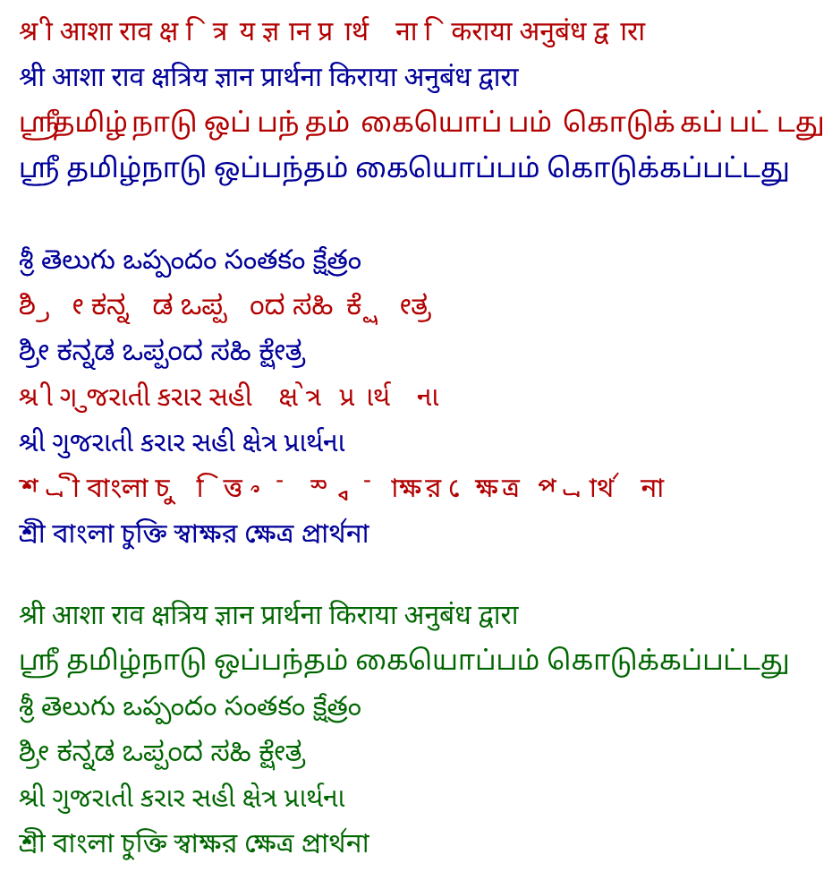

# 0001 — Text rendering for Indic scripts

Date: 11 October 2026 · Status: accepted · Plan task: P3-01 · Audit finding: M1

## Decision

Text written into PDFs (signer-typed field values, names on the signing record) is shaped with **HarfBuzz** (`harfbuzzjs`) and drawn as **glyph outlines** at the shaped positions, using Noto Sans fonts. pdf-lib's own `drawText` is used only for text the built-in fonts cover (plain Latin).

The code is in `server/src/services/textShaping.service.js`.

## Why

Indian scripts join, reorder and stack characters. Drawing one glyph per character produces text that is wrong, not merely ugly. Three approaches were rendered and compared for Hindi, Tamil, Telugu, Kannada, Gujarati and Bengali:

| Approach | Result |
| --- | --- |
| pdf-lib `drawText` with `@pdf-lib/fontkit` | Crashes on the first Hindi string (`regeneratorRuntime is not defined`) |
| pdf-lib `drawText` with the maintained `fontkit` 2 | Draws, but wrongly in every script: marks detached, letters spread apart, Bengali and Kannada unreadable. Crashes on Telugu. |
| HarfBuzz shaping, glyph outlines drawn with `drawSvgPath` | Matches the reference in all six scripts |

The reference is the same text drawn by a browser-grade engine (Skia with its own HarfBuzz).

Red rows are pdf-lib `drawText`. Blue rows are the chosen approach. Green rows at the bottom are the reference. The Telugu red row is missing because that approach crashed.

An automated test (`server/tests/pdf/unicode-text.test.js`) repeats the comparison for each script on every run. Correct rendering scores 1.00 on its measure; text shifted by a few pixels or in the wrong order scores 0.48 to 0.66; the test requires more than 0.95.

## Consequences

- **Not selectable.** Shaped text is vector outlines. It is sharp at any zoom and identical in every reader, but cannot be selected, copied or searched. Field values and names are also stored in the database and listed in the audit log, so nothing is lost as data.
- **Fonts ship with the server.** Seven Noto Sans families are installed from `@expo-google-fonts/*`. They add about 28 MB to `node_modules` because every weight is included; only Regular and Bold are used. Trimming is possible later.
- **Adding a script** means adding its font package and one row each in `FONT_FILES` and `SCRIPT_RANGES`. A character no installed font covers is skipped, and on the signing record shows as "?" only when the whole line is otherwise Latin.
- **Later markets.** HarfBuzz already handles Arabic joining and right-to-left runs, and Japanese needs only a font. Two things are not built yet: a font for each (the Japanese one is several megabytes), and bidirectional ordering for lines that mix right-to-left and left-to-right text.
- **Guided templates (P4-02)** generate whole documents, not single lines. This decision does not settle that; a page-layout engine is still to be chosen. The shaping code here can serve as its text layer.

## Rejected alternatives

- **Draw the text in the signer's browser and upload an image.** Correct shaping for free, but the server would be stamping an image it cannot check against the value it stores.
- **Render every field through a headless browser.** Correct, but a browser process per signature is far too heavy for a 512 MB instance.
