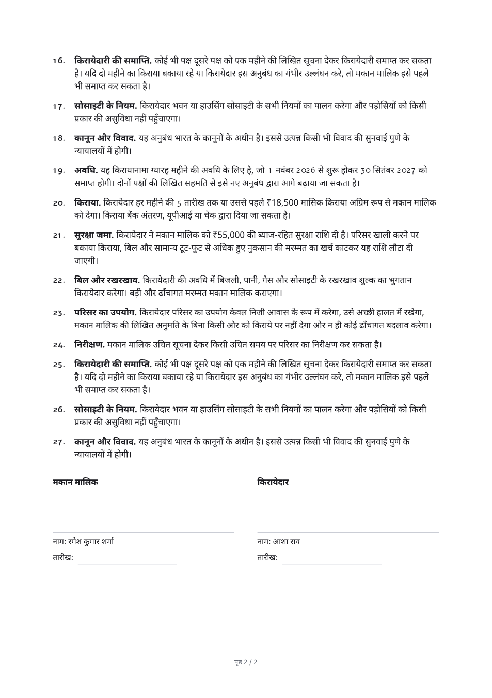

# 0002 — How guided templates become PDFs

Date: 11 October 2026 · Status: accepted · Plan task: P4-02

## Decision

A guided template is laid out and drawn **in the API process, on pdf-lib**, by a small layout engine written for the purpose: `server/src/services/templateRender.service.js`. Text in Indian scripts goes through the HarfBuzz shaping chosen in decision 0001. No headless browser is used.

## What was compared

| | Own layout on pdf-lib | Headless browser in a worker service |
| --- | --- | --- |
| Indian scripts | Correct, through the shaping already built and tested in phase 3 | Correct, the browser shapes text itself |
| Where it runs | Inside the API container | A second service with a browser installed, called over the network |
| Memory | Negligible beside the API's own use (measured below) | A browser process, typically several hundred MB, in a container sized for it |
| Speed | About 0.6 s for two pages of Hindi; under 0.1 s for English | Start-up of the browser on a cold container, then the render |
| Same input, same file | Yes, byte for byte (tested) | Not guaranteed across browser versions |
| Where fields land | Known exactly: the engine places the signature line itself | Has to be read back out of the rendered page |
| Layout features | Only what the engine implements: headings, paragraphs, numbered clauses with sub-points, lists, two-column tables, signature blocks, page breaks | Anything HTML and CSS can do |
| Selectable text | Latin yes; Indian scripts no (they are drawn as outlines) | Yes, in every script |

**Only the left column was built and measured.** The right column is from how such services are normally deployed, not from a prototype. The plan allowed three days to compare both; the phase 3 result made the first option cheap enough to try first, and it met the test the plan set, so the browser option was not built.

## Measurements

A two-page rent agreement in Hindi, 27 clauses, two signers (`server/tests/templates/fixtures.js`), rendered on a development laptop after the fonts were loaded:

| | Result | Limit in the test |
| --- | --- | --- |
| Time | 0.5 to 0.6 s | 4 s |
| Extra heap after the render | none measurable | 120 MB |
| File size | 298 KB | 1.5 MB |
| Pages | 2, text within the margins on both | |

The test runs on every build: `server/tests/templates/render.test.js`, "P4-02".

## Consequences

- **One service, one deploy.** Nothing new to host, secure or keep warm.
- **Hindi files are larger and slower than English ones**, because every glyph is drawn as an outline: about 150 KB a page against about 5 KB. Acceptable for agreements of a few pages. A fifty-page Hindi document would be about 7 MB and should be looked at before such templates are offered.
- **Text in Indian scripts cannot be selected, searched or read aloud** in the PDF. This is the same limit as decision 0001 and has the same remedy if customers ask: an invisible text layer.
- **Layout is deliberately plain.** A template that needs columns, images, letterheads or free positioning cannot be expressed today. If the housing-society or lending packs need them, the choice is to extend the engine or to revisit the browser option for those templates only. The definition format (blocks of text with placeholders) would carry over to either.
- **Paper size is A4**, the size used in India. Documents a sender uploads keep whatever size they have.
- **The renderer is deterministic**: creation dates in the file are fixed and nothing reads the clock, so a document can be regenerated from its template version and answers and compared with what was sent.

## Revisit when

- A pack needs layout the engine cannot do.
- Selectable Indian-script text becomes a requirement (accessibility rules, or customers who search their archives).
- Documents routinely exceed ten pages in an Indian script.
